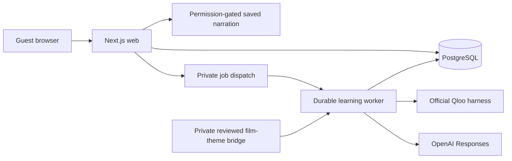

# Architecture

IMMERSION separates cultural relevance, source permission, language support, fixed assessment, and generated feedback. Qloo supplies query-relative cultural evidence; the application owns eligibility and editorial interpretation; bounded model output supplies optional study guidance. None of these establishes educator review, a certified level, or measured learning.

## Runtime boundaries

The web service renders the UI, authenticates the guest cookie, validates commands, and commits durable jobs. The worker processes jobs separately through [`scripts/worker.ts`](../scripts/worker.ts). Local mode polls PostgreSQL; Cloud Run uses authenticated Cloud Tasks dispatch and recovery scheduling. A dispatch failure leaves the committed job available for recovery.

The web deployment holds database credentials, the trusted database CA, capability flags, and dispatch configuration. Only the worker receives Qloo/OpenAI credentials and the private film-theme bridge. Its model tools have no general web, filesystem, other-learner, or assessment-key access. Private TLS, secret grants, IAM/OIDC, and release operations are described in [the deployment guide](../deploy/gcp/README.md).

| Module                                                   | Responsibility                                                                                                                           |
| -------------------------------------------------------- | ---------------------------------------------------------------------------------------------------------------------------------------- |
| `src/app/`, `src/components/`                            | Server-rendered routes and explicit interactions for discovery, reading, narration, fixed practice, writing feedback, and review         |
| `src/server/store.ts`                                    | Owner-scoped learning state, transactional commands, source delivery, adaptation, export, and deletion                                   |
| `src/server/live-store.ts`                               | Jobs, confirmation ownership, leases/checkpoints, cancellation, idempotency, budgets, cached evidence, and permission-gated result reads |
| `src/server/learning-worker.ts`                          | Resolution, eligibility snapshots, same-shortlist ranking, study planning, and coaching orchestration                                    |
| `src/integrations/qloo-live.ts`                          | Strict request/result boundary through the pinned official Qloo harness                                                                  |
| `src/integrations/teaching.ts`, `src/domain/teaching.ts` | Bounded model tools and deterministic output validation                                                                                  |
| `src/domain/discovery.ts`, `src/domain/learning.ts`      | Cultural ordering, editorial baseline, eligibility/support policy, adaptation, rights, and review scheduling                             |
| `src/server/media.ts`                                    | Source-bound narration manifests and gated byte-range serving                                                                            |
| `src/content/`, `migrations/`                            | Original source/assessment seeds, immutable identities, schema, constraints, and permissions                                             |

## Discovery, in order

1. A guest explicitly searches a public cultural name as artist, movie, book, person, brand, or place. Search rejects contact details, links, and credential-like input. At most five matches are offered.
2. Confirmation must select a candidate from that guest’s successful resolution run, with evidence no older than seven days. At most three interests are confirmed. Confirmation/removal increments the learner version and cancels pending discovery based on the previous interests.
3. A discovery request captures the current learner version, confirmed identities, preferences, source versions, and completed versions. The worker rechecks source integrity and delivery permissions before constructing options.
4. A private reviewed bridge associates real **film identities** with editorial themes and cultural clusters. Eligible original stories must fit the appropriate reading/listening band and session time. Unseen stories are preferred within a theme; a supported revisit is explicit when alternatives are exhausted. Taste/support adaptation remains a separate application policy.
5. One Qloo Insights request ranks the exact eligible film-reference shortlist. Signals are confirmed identities; candidate IDs are supplied explicitly. Output must belong to those candidates. Missing results receive no invented rank. Only ordinal order within that request is used; affinity values are not compared across profiles or treated as enjoyment probabilities.
6. If configured, an OpenAI `ToolLoopAgent` inspects eligible original sources before producing a structured study invitation. It can choose among eligible stories within each protected route and supply a focus, warm-up question, and exact source quote. Validation rejects changed route identities/order, unknown or duplicate versions, and fabricated quotations. AI failure preserves a labeled deterministic selection from the recorded cultural order.

Qloo does not index these original lessons or supply their text. A film → theme → story relationship is IMMERSION’s editorial bridge, not an adaptation, affiliation, endorsement, or license. Source permissions and working language bands are independent of affinity.

The editorial baseline and Qloo-informed comparison use the same eligible film-reference pool and learner constraints. Shared anchors use the identical chosen story in both lists, preventing a model’s within-theme choice from appearing to be a Qloo ordering change. Explicit same-thread support feedback may prioritize that thread; original provider ranks remain visible. Ordering differences are implementation observations, not causal lift or educational outcomes.

## Fixed practice and optional coaching

The 36 original stories each have three passages, three fixed source questions, and one expression exercise: 144 assigned exercises. Session, assessment, content-version, and objective assignments are bound by service checks and composite database constraints. Source-question answers are counted once. Expression practice uses the authored answer with bounded normalization and at most three attempts; it is separate from the three-question comprehension result.

Taste and self-reported difficulty remain separate from objective answers. With adaptation consent, the deterministic policy can keep a liked thread and add support, or change an unappealing topic while retaining the challenge. A `hard` self-report explicitly requests extra support: even strong source-question results and a stretch-ready history keep the challenge steady. Weak objective results may still select an easier piece. The request does not lower fixed scores, change working bands, or override taste. New completion events record `separate-taste-comprehension-support-2`; historical decisions are not rewritten. One session does not automatically change self-selected bands. Vocabulary review uses server-enforced due times and a 1/3/7/14-day schedule, not a claim of measured retention.

Extra support carries into the next story unless the learner chooses independent reading. Translations begin visible, authored practice hints and the source panel begin expanded, and each remains closable. Recorded narration initially uses 0.75× when no speed has been selected; a manual selection saved in browser-tab storage takes precedence. Audio never starts automatically. These are presentation supports, not easier assessment answers or a new proficiency estimate.

Opinion coaching is available after the assigned fixed exercises. It accepts a 5–800-character typed answer and explicit `consent: true`. A session permits three queued feedback attempts, including attempts that later fail or are cancelled; an idempotent replay is not a new attempt.

The coaching agent must first inspect the exact assigned source. Output contains one useful success, at most two corrections, a generated Spanish example, a retry prompt, and one or two source quotations. Code verifies that each correction’s `before` span is an exact, non-overlapping part of the submitted answer and that its replacement differs. Quotations must be exact substrings of the identified source segments. A `try-again` output must contain no corrections. These validators enforce structure and grounding; they do not certify the linguistic quality of every valid-looking suggestion.

Study planning and coaching each use a maximum two-step tool loop: forced source inspection, then structured output. The production model boundary is pinned to OpenAI Responses and `gpt-6.1-sol`, with SDK retries disabled, at most two HTTP calls, time/size bounds, and `store: false`. Models cannot grant permissions, change assigned versions or protected cultural order, publish unchecked output, or create comprehension/fluency scores.

## Durable execution and cost bounds

Jobs persist as `queued → running → succeeded`, with `failed` and `cancelled` terminal paths. A partial unique index allows one active job per guest. UUID idempotency keys bind to request fingerprints: the same key replays the same action; a different payload with that key is rejected.

Workers claim rows with `FOR UPDATE SKIP LOCKED` and a 120-second lease, for at most three claims. A lease token guards checkpoints and publication. Checkpoints extend the lease; an expired or superseded worker cannot publish. Discovery checks the captured learner version so changed preferences invalidate stale results. Cancellation and lost leases are checked between stages. An already dispatched external request may consume its reservation, but cannot publish a cancelled result.

Before each paid attempt, a transaction takes a credential-scoped advisory lock and reserves a unique `(run, provider, step)` entry. It atomically enforces per-provider rolling-day, per-guest, per-minute, and per-run limits:

| Limit                                           | Qloo | Model |
| ----------------------------------------------- | ---- | ----- |
| Default attempts per credential per rolling day | 100  | 120   |
| Default attempts per guest per rolling day      | 15   | 12    |
| Attempts per provider credential per minute     | 20   | 20    |
| Attempts per run                                | 1    | 2     |

A guest may create 40 live runs in a rolling day. Completed checkpoints and valid Qloo cache entries are reused. If an attempt was reserved but interrupted before its evidence was saved, that step is not repeated automatically. This bounds duplicate spending; it does not promise exactly-once external execution. Reservations count attempts, not successes, tokens, invoices, or remaining account credit.

The Qloo adapter uses the pinned official harness, validates identities/categories, and supplies an allowlisted child-process environment. A fetch guard permits one bounded request to the fixed hackathon endpoint without redirects or implicit retries. Raw upstream prose and credentials do not become UI errors. Cache keys include the adapter version, credential fingerprint, and exact request. Reused records retain their original evidence timestamp and are labeled cached.

## Source integrity, permissions, and narration

Migration seeds reject changed source or assessment data under an existing published identity. A canonical source-integrity hash is checked when serving content. Current release state, expiry/revocation, host permission, and transcript permission gate delivery; adaptation and model processing require separate grants.

The schema currently has `UNIQUE(slug)` on content versions. It does not implement multiple simultaneous editions of one slug or automated version promotion. An authored revision needs distinct source ID/slug, version identity, and assessment IDs. Immutable checks protect current published identities; they are not a complete editorial publishing interface.

Sessions, live results, keyed replay, and export re-enter the source permission boundary. Altered or unavailable content is not revived by an older successful result. Current immutable source identity/hash checks protect previously verified quotations. Exports omit full Spanish source passages and live source-quote fields; saved-word reviews include the corresponding English passage translation as context while delivery permissions remain valid. Unavailable-source details are withheld. AI-derived result reads additionally require current teaching permissions.

Fifteen approved MP3 narrations are prebuilt assets, not runtime generation. The manifest binds each file to its exact piece/version and SHA-256 of Spanish segment texts joined with two newline characters. It provides validated passage timing, duration, voice, and model metadata. File resolution rejects traversal/symlink escape and unreasonable sizes. See [narration provenance](../assets/audio/README.md).

`GET /api/media/[sessionId]/manifest` and `GET`/`HEAD /api/media/[sessionId]` authenticate the owner and recheck source delivery permissions. Audio responses are private/no-store with validated single byte ranges. Serving an existing narration requires host/transcript permission; withdrawing **future model-processing permission alone** does not withdraw that recording’s delivery grant.

Missing/invalid narration returns an unavailable manifest. `una-cancion-dos-versiones`, `el-puesto-que-cambio-la-hora`, and `el-banco-que-se-movia` have no approved MP3; they provide labeled browser speech, when available, and the original text. Playback requires an explicit action, supports speed/seeking, stores position in browser-tab storage, and marks the current audio passage without forced scrolling. No learner audio is recorded or uploaded.

## Guest access and retention

The `immersion_guest` cookie is HTTP-only, SameSite Lax, secure on HTTPS, and expires in the browser after 30 days. PostgreSQL stores only its bearer hash. Learning/session/run access is owner-scoped. Same-origin JSON checks, strict schemas, row locks, optimistic versions, and database constraints protect mutations. Isolation uses application queries; PostgreSQL row-level security and production accounts are not implemented.

There is no account recovery or cross-device sign-in. Cookie expiry/clearing loses access but **does not delete server records**. Guest profiles, notes, responses, activity, confirmed interests, runs, and results remain until explicit deletion; no automatic guest-retention cleanup exists. Owner export is permission-filtered and excludes credentials, future answer keys, full Spanish source passages, and live source-quote fields; it retains permitted translated review context. Deletion cascades through owned learning records and jobs.

Minimal provider reservations retain hashed guest/credential scopes separately from deleted run ownership. Qloo cache entries expire after 24 hours. Periodic worker maintenance removes expired cache and quota reservations older than 48 hours; it does not delete guests, and requires the worker to run. These are application retention behaviors, not promises about external provider storage. Browser-tab storage separately holds pending command recovery and playback position.

Qloo receives cultural queries and confirmed/candidate identities, not written practice. OpenAI receives source/support context for requested study activity; opinion coaching additionally includes the explicitly consented answer. No microphone recording, pronunciation assessment, or educational-outcome measurement is implemented.

## API surface and verification

| Endpoint                                                                     | Purpose                                                                    |
| ---------------------------------------------------------------------------- | -------------------------------------------------------------------------- |
| `POST /api/guest`                                                            | Adult-confirmed guest creation                                             |
| `POST /api/commands`                                                         | Typed, idempotent learning commands                                        |
| `GET /api/interests`                                                         | Interests, current version, latest owned runs, capability flags            |
| `POST /api/interests/resolve`                                                | Explicit cultural search job                                               |
| `POST` / `DELETE /api/interests/confirm`                                     | Confirm an owned search candidate or remove an interest                    |
| `POST /api/discovery/runs`                                                   | Discovery bound to the expected profile version                            |
| `GET /api/runs/[id]`; `POST /api/runs/[id]/cancel`                           | Owned status/result and cancellation                                       |
| `GET` / `POST /api/practice/feedback`                                        | History/remaining attempts and consented coaching                          |
| `GET /api/profile/export`; `DELETE /api/profile`                             | Permission-filtered export and confirmed deletion                          |
| `GET /api/media/[sessionId]/manifest`; `GET` / `HEAD /api/media/[sessionId]` | Narration availability and gated audio                                     |
| `GET /api/health`                                                            | Database, configured capabilities, and worker heartbeat; no provider probe |

Provider-free unit, real-PostgreSQL, and browser suites cover concurrency/budgets, worker interruption, cancellation, ownership, stale profiles, source tampering and withdrawal, coaching span/quote validation, consent, keyboard controls, mobile layout, and narration. They verify implementation behavior, not teaching effectiveness or complete accessibility certification.

Dated results belong in [VERIFICATION](VERIFICATION.md); measured provider behavior in [LIVE-OBSERVATIONS](LIVE-OBSERVATIONS.md); deployment operations in [the deployment guide](../deploy/gcp/README.md). Private plans, keys, raw provider responses, and canonical bridge configuration remain outside published source and build contexts.
